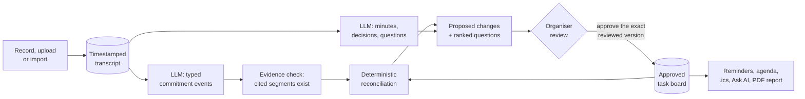
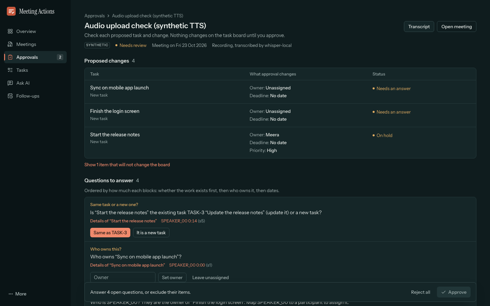
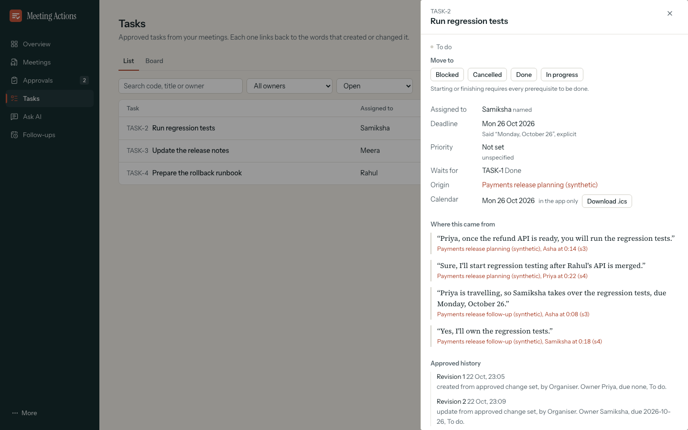
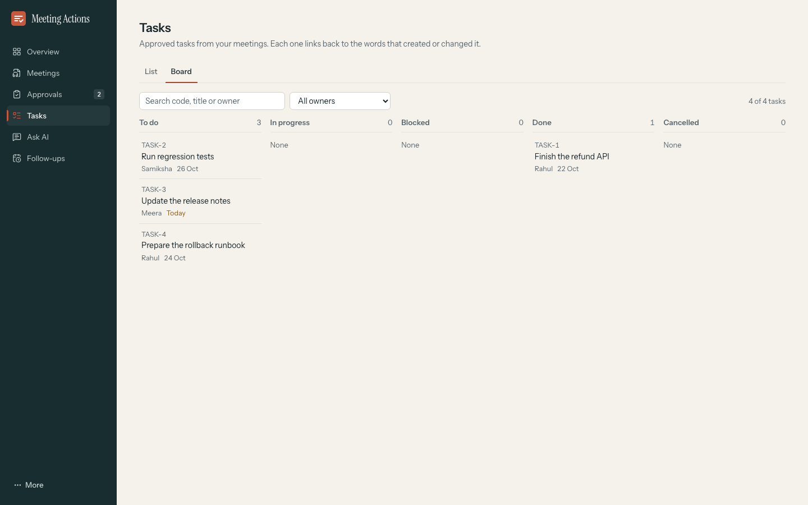
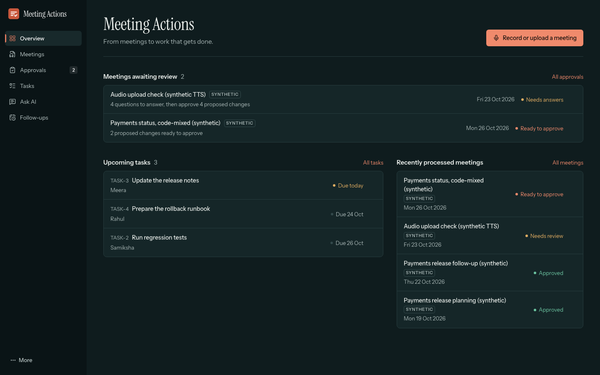

# Meeting-to-Action Tracker Agent

[](https://github.com/sgtsujith141-wq/Zeroshot-meeting_agent/actions/workflows/ci.yml)

VIT Zero Shot Hack 2026, Track 5 (GenAI & Agentic Intelligence), problem statement 5.3.

The app turns meeting recordings and transcripts into **reviewed, tracked commitments**:
minutes, decisions with reasons, and actions with owner, due date, priority and
dependencies. Every item is tied to the transcript lines that support it. Nothing becomes a
task until the organiser approves it, and later meetings **update the existing tasks**
instead of duplicating them.


<sub>All screenshots show the demo workspace: four clearly labelled synthetic meetings. No real
meeting data is in this repository.</sub>

## Status

What has and has not been verified, as of the last commit:

| Area | Status |
|---|---|
| Live language model | **Verified** with a local Ollama model (`qwen3:8b`) |
| Recording in the browser → transcript | **Verified** in Chromium with its capture device playing recorded speech: words on screen 6.5–8.4 s after *Transcribe recording*, using local Whisper |
| A person speaking into the demo laptop's microphone | **Not verified** by the developers (macOS denied the tools microphone access). Operator check: [`docs/LIVE_AUDIO_DEMO.md`](docs/LIVE_AUDIO_DEMO.md) §2 |
| Speaker separation (diarization) | **Unverified**: needs a Sarvam key. Local Whisper labels every line `SPEAKER_00`, and the app says so |
| Gemini and Sarvam adapters | Implemented and checked against their SDKs; **unverified live** (no API keys) |
| Email delivery | Never sent (no SMTP configured); the app reports "approved but not sent" |
| Meeting report PDF | **Verified**, built from the stored records and checked page by page |
| Official three-real-meeting evaluation, WER, human summary ratings | **NOT MEASURED** (no consented real recordings yet) |

Requirement-by-requirement evidence: [`SUBMISSION_CHECKLIST.md`](SUBMISSION_CHECKLIST.md) and
[`docs/ROUND2_FINAL_REPORT.md`](docs/ROUND2_FINAL_REPORT.md) §18.

## How it works

The differentiator is a **commitment reconciliation engine**. The language model only
describes what was said, as ordered, typed events (propose, confirm, reassign, change
deadline, cancel…), each citing transcript segment IDs. Deterministic code folds those events
into the current state of the work, checks them against the approved task board, and asks the
organiser the fewest questions needed when it can't act safely.



The full diagram and design rules are in [`docs/architecture.md`](docs/architecture.md).

## Screenshots

<table>
  <tr>
    <td width="50%" valign="top"><br><b>New meeting.</b> Record in the browser, upload audio or video, or import a transcript.</td>
    <td width="50%" valign="top"><br><b>Transcript first.</b> The words appear in seconds and can be corrected before the analysis.</td>
  </tr>
  <tr>
    <td width="50%" valign="top"><br><b>Results.</b> Summary, discussions, decisions and actions, each linked to the lines it came from.</td>
    <td width="50%" valign="top"><br><b>Before → after.</b> A later meeting updates TASK-2 instead of creating a duplicate.</td>
  </tr>
  <tr>
    <td width="50%" valign="top"><br><b>Targeted questions.</b> Unclear owners, ambiguous dates and possible duplicates are asked, not guessed.</td>
    <td width="50%" valign="top"><br><b>Provenance.</b> Every task keeps the quotes that created or changed it, and its revision history.</td>
  </tr>
  <tr>
    <td width="50%" valign="top"><br><b>Ask AI.</b> Owner and deadline questions are read straight from the task records; other questions get cited answers.</td>
    <td width="50%" valign="top"><br><b>Task board.</b> Starting or finishing a task requires its prerequisites to be done.</td>
  </tr>
  <tr>
    <td width="50%" valign="top"><br><b>Meeting report.</b> An A4 PDF built from the stored records; unapproved work is marked DRAFT.</td>
    <td width="50%" valign="top"><br><b>Action register</b> and the changes to earlier commitments.</td>
  </tr>
  <tr>
    <td width="50%" valign="top"> <br><b>Phone.</b> Every screen works at 390 px without horizontal scrolling.</td>
    <td width="50%" valign="top"><br><b>Dark theme.</b> Switch between light and dark in the More menu.</td>
  </tr>
</table>

## Features

- **Three ways in:** record in the browser, upload audio or video (Sarvam batch STT, or local
  Whisper), or import JSON, Sarvam JSON, VTT, SRT or plain text.
- **Transcript before analysis:** real processing stages with measured times; correct
  misheard lines, then analyse.
- **Minutes** with key discussions, decisions and their reasons, and unresolved questions.
- **Actions** with owner, due date,
  priority and dependencies. Relative deadlines ("by Friday") are resolved against the
  meeting date; missing, anonymous or group owners and ambiguous deadlines become questions.
- **Organiser approval:** answer questions, map speaker labels to people (re-checks
  everything without a model call), edit or exclude items. Approval is pinned to exactly
  what was reviewed; a stale proposal is refused.
- **Across meetings:** reassignments, new deadlines, cancellations and completions update
  the existing tasks, with before → after shown at review.
- **Tracking:** list and board, a finite status machine with prerequisite gating and cycle
  protection, revision history.
- **Follow-ups:** next-meeting agenda of pending items, `.ics` calendar export, in-app
  reminders and notifications, summary sharing that needs approval (and SMTP to send).
- **Ask AI** across meetings: instant answers from the task records, and grounded answers
  with validated citations, or "nothing found in stored meetings".
- **Meeting report PDF** with approval state, action register and transcript appendix.
- English, plus Hindi/Kannada code-mixed text; light and dark themes; keyboard and screen
  reader checked (axe WCAG 2.1 A/AA, 0 violations).

## Quick start

Requirements: Python 3.12, Node 20+, FFmpeg, and either a Gemini API key or a local
[Ollama](https://ollama.com) with `qwen3:8b` pulled (`ollama pull qwen3:8b`).

```bash
# 1. Configuration: creates a git-ignored .env with a random ORGANIZER_TOKEN
./scripts/setup_env.sh
#    Optional: add GEMINI_API_KEY and SARVAM_API_KEY to .env (never commit it)

# 2. Backend (Python 3.12 via uv). Add --group local-stt for the local Whisper fallback
cd backend && uv sync --group local-stt && cd ..

# 3. Frontend build (served by the backend)
cd frontend && npm ci && npm run build && cd ..

# 4. Run: API + web UI + reminder worker on http://127.0.0.1:8000
cd backend && .venv/bin/uvicorn app.main:app --host 127.0.0.1 --port 8000
```

Open http://127.0.0.1:8000 and sign in with the `ORGANIZER_TOKEN` from `.env`. The
schema is created automatically on first start (SQLite at `backend/data/app.db`). No
migrations need to be run, and existing data is never dropped.

Frontend development with hot reload: `cd frontend && npm run dev`, then open
http://localhost:5173 (`/api` is proxied to :8000).

The reminder worker runs inside the backend process, polling every
`REMINDER_POLL_SECONDS`. It only works while the backend runs.

## Demo workspace

A separate, resettable database of four clearly labelled synthetic meetings for presenting.
It never touches the working database (`backend/data`).

```bash
backend/.venv/bin/python scripts/demo_workspace.py reset    # rebuild from demo/workspace.sql; the old copy is kept as a backup
backend/.venv/bin/python scripts/demo_workspace.py serve    # http://127.0.0.1:8000
backend/.venv/bin/python scripts/demo_workspace.py verify   # read-only checks of the demo story
```

Live recording route, preflight and fallbacks: [`docs/LIVE_AUDIO_DEMO.md`](docs/LIVE_AUDIO_DEMO.md).

## Demo path (about 3 minutes)

0. **Intro.** A short intro plays on the first load of a browser session (and at `/?present=1`);
   a refresh does not replay it. Esc or *Skip intro* leaves it.
1. **Overview** lists meetings awaiting review, upcoming tasks and recently processed meetings.
2. **New meeting.** Choose *Record audio* (the browser's microphone), *Upload recording*
   (needs `SARVAM_API_KEY` or the optional local Whisper) or *Upload transcript*
   (`demo/*.json`, `.txt`, `.vtt`, `.srt`, or *Use the synthetic demo transcript*). A
   recording is transcribed first: the words appear in seconds and can be corrected, then
   *Analyze meeting* finds decisions and tasks.
   Or use the CLI: `backend/.venv/bin/python scripts/api.py ingest demo/synthetic_meeting_1_planning.json`
3. **Results.** Summary, key discussions, decisions, action items and questions to
   clarify, each linked to the transcript lines it came from. *Download meeting report*
   gives an A4 PDF (`GET /api/meetings/{id}/report.pdf`).
4. **Approvals.** Every proposed change reads as before → after, computed by the same
   rules approval applies. Answer the questions (for example, "Who is SPEAKER_03?" is
   answered by mapping the speaker), open a row for its evidence and history, edit or
   exclude items, then approve.
5. **Tasks.** The approved tasks as a list or a board, with dependencies, provenance and
   revision history in the task drawer.
6. **Later meeting.** Ingest `demo/synthetic_meeting_2_followup.json`. The approval shows
   **before → after changes to the existing tasks**, and asks before cancelling anything
   ambiguous.
7. **Ask AI.** Owner, deadline, pending, blocked and "what is X working on" questions are
   answered from the approved task records, without a model call. Other questions get
   grounded answers with citations. Each answer shows its measured time.
8. **Follow-ups** (agenda, calendar export, reminders, notifications) and **Diagnostics**
   in the More menu (live services, evaluation runs).

The full talk track is in [`docs/demo-script.md`](docs/demo-script.md).

## Evaluation

Same model and settings for every pipeline (`evaluation/run_eval.py`). *Baseline*: one call
returns the final actions. *Baseline + dates*: plus the deterministic date and
anonymous-owner rules. *Engine*: typed events, then reconciliation. All fixtures are
synthetic and written by the developers.

| Fixture set (live run) | Baseline F1 | Baseline + dates F1 | **Engine F1** | Safety checks (B / B+d / E) | Fully correct (B / B+d / E) |
|---|---|---|---|---|---|
| Starter, 12 cases, qwen3:8b (pre-registered) | 0.348 | 0.696 | **0.818** | 5/8 · 5/8 · **8/8** | 6 · 7 · **10** of 12 |
| Starter, 12 cases, llama3.1:8b | 0.720 | 0.800 | **0.900** | 4/8 · 4/8 · **8/8** | 8 · 8 · **10** of 12 |
| Fresh holdout v2, 10 cases, qwen3:8b | 0.500 | **0.750** | 0.625 | 5/10 · 5/10 · **10/10** | 3 · 3 · **7** of 10 |
| Fresh holdout v3, 8 cases, qwen3:8b (pre-registered, first run) | 0.333 | **0.667** | 0.545 | 2/7 · 2/7 · **5/7** | 3 · 4 · **5** of 8 |

The engine is consistently **safer** (it asks instead of guessing or duplicating) and gets
more whole cases right, but on the two fresh holdouts it is **not** better on item-level F1
than the baseline with date rules. A replay of the recorded v3 responses after later rule
changes gives 0.727; that number is post hoc, not a held-out result. Method, per-case
mismatches and caveats: [`docs/evaluation.md`](docs/evaluation.md).

**Measured on the demo laptop** (Intel i9-9980HK, CPU only):

| Measurement | Result |
|---|---|
| Transcription of a 14.7 s clip, local Whisper small, model loaded | 4.6–5.0 s |
| *Transcribe recording* → words on screen | 6.5–8.4 s |
| Full analysis (interpretation and minutes in parallel, `qwen3:8b`) | 70.8–94.7 s over 3 runs |
| Ask AI from the task records | median 4 ms over HTTP; 20 ms in the UI |
| Ask AI grounded answer with the model | 17.9–40.0 s |
| Meeting report PDF | 0.35–0.7 s |

## Tests

```bash
cd backend && .venv/bin/pytest -q          # 133 offline tests: fold, dates, identity, API flows, providers, metrics
cd frontend && npx playwright test e2e/flows --grep-invert "upload → processing|ask with the model|model is down|diagnostics live test"
                                           # 105 browser tests incl. live recording and accessibility, on disposable sandboxes (about 7 min)
cd frontend && npx playwright test e2e/flows/slow.spec.ts   # 4 live-model flows (Ollama; about 5 min)
cd frontend && npx playwright test e2e/judge                # judge rehearsal: 5 scenarios on demo data + 2 with live Whisper and Ollama
cd frontend && E2E_TOKEN=<token> npx playwright test e2e/smoke.spec.ts   # read-only checks of a running server
cd frontend && SCREENS=1 VW=390 npx playwright test e2e/screens.spec.ts  # viewport screenshots + overflow/clipping checks
backend/.venv/bin/python evaluation/run_eval.py --provider ollama --model qwen3:8b   # fixture experiment
backend/.venv/bin/python scripts/provider_smoke.py --audio <recording>               # live Gemini/Ollama/STT check
backend/.venv/bin/python evaluation/real_eval.py init|export|report ...              # official metrics (real data)
```

- API integration tests use recorded LLM JSON (provider `test-fixture`). They test the
  workflow, not the model; model quality is measured only by the runs in `evaluation/results/`.
- Browser tests start their own backend per test, with a copy of the demo data (or an empty
  database) and a random token. They never touch a running server or its data, and they fail
  on any page error, console error or unexpected API error. They need `backend/.venv` and a
  processed demo database (a pinned copy in `frontend/e2e/.demo-snapshot/`, git-ignored, is
  used when present). Every control and its result: [`docs/UX_FUNCTIONAL_AUDIT.md`](docs/UX_FUNCTIONAL_AUDIT.md).
- CI (GitHub Actions) runs the offline backend tests and the frontend build. Green CI does
  not prove the microphone, the live model or the PDF renderer; those run locally.

## Configuration (`.env`)

| Variable | Purpose |
|---|---|
| `ORGANIZER_TOKEN` | Required. Bearer token for every API call except `/api/health`. |
| `LLM_PROVIDER` | `auto` (Gemini if a key exists, else Ollama), `gemini` or `ollama`. |
| `GEMINI_API_KEY`, `GEMINI_MODEL` | Gemini via `google-genai` (default `gemini-3.8-flash`). |
| `OLLAMA_BASE_URL`, `OLLAMA_MODEL`, `OLLAMA_NUM_CTX` | Local model (default `qwen3:8b`). |
| `LLM_TEMPERATURE`, `LLM_SEED`, `LLM_TIMEOUT_SECONDS` | Generation settings (0, 7, 600). |
| `LLM_CONCURRENT_MINUTES` | `1` (default) runs the minutes call alongside interpretation; `0` runs them one after the other. |
| `STT_PROVIDER`, `WHISPER_MODEL`, `WHISPER_LANGUAGE` | `auto` (Sarvam if a key exists, else local Whisper if installed), `sarvam` or `whisper`. |
| `SARVAM_API_KEY`, `SARVAM_STT_MODEL`, `SARVAM_STT_MODE`, `SARVAM_LANGUAGE_CODE` | Sarvam batch STT (`saaras:v4`, `codemix`, diarization). |
| `DATA_DIR`, `MAX_UPLOAD_MB`, `CORS_ORIGINS`, `DEFAULT_TIMEZONE`, `REMINDER_POLL_SECONDS` | Storage and server. |
| `SMTP_*` | Optional. Without it, nothing is ever emailed. |

## Privacy

- Every input mode requires the organiser to confirm that participants consented, and says
  which services receive the data; the meeting records the consent.
- With the default setup everything runs locally: Whisper, Ollama, SQLite and files on disk.
  Data goes to Gemini or Sarvam only if their keys are configured.
- Every API route needs the organiser token; media is served through signed, expiring URLs.
- No task is created and no message is sent without approval.
- Keys and the token live in a git-ignored `.env`. The repository holds only synthetic
  fixtures and demo data; real recordings stay private.

Details: [`docs/privacy.md`](docs/privacy.md).

## Repository map

```
backend/app/        FastAPI app: api/, services/ (reconcile, dates, identity, changesets,
                    processing, task_answers, report, llm/, speech/, memory, reminders,
                    calendar, agenda, summary)
backend/tests/      pytest (offline)
frontend/src/       React + TypeScript + Tailwind UI
frontend/e2e/       Playwright: flows/ (fast and slow), judge/ (rehearsal), smoke, screens
evaluation/         run_eval.py, real_eval.py, RUBRIC.md, fixtures/, annotations/, results/
demo/               SYNTHETIC demo transcripts and workspace.sql (labelled; not real meetings)
docs/               architecture, API, privacy, evaluation, Round 2 reports; round2/ screenshots
scripts/            setup_env.sh, api.py (CLI), demo_workspace.py, provider_smoke.py, md_to_pdf.py
ZeroShot_PS53_Claude_Starter_Kit/   the organisers' brief and starter fixtures
```

## Documentation

- [Architecture and design rules](docs/architecture.md)
- [API reference](docs/api.md)
- [Privacy, consent and security](docs/privacy.md)
- [Evaluation methodology and results](docs/evaluation.md)
- [Known limitations](docs/limitations.md)
- [Live audio demo: route, preflight, fallbacks](docs/LIVE_AUDIO_DEMO.md)
- [Demo script (5–7 min)](docs/demo-script.md) and [judge Q&A](docs/judge-qa.md)
- [Submission checklist](SUBMISSION_CHECKLIST.md)
- Round 2: [final technical report](docs/ROUND2_FINAL_REPORT.md) ([PDF](docs/ROUND2_FINAL_REPORT.pdf)),
  [control audit](docs/ROUND2_CONTROL_AUDIT.md),
  [pass 1: functional](docs/ROUND2_PASS1_FUNCTIONAL.md),
  [pass 2: AI](docs/ROUND2_PASS2_AI.md),
  [pass 3: UX](docs/ROUND2_PASS3_UX.md),
  [pass 4: judge rehearsal](docs/ROUND2_PASS4_JUDGE_REHEARSAL.md)
- Before Round 2: [final product audit](docs/FINAL_PRODUCT_AUDIT.md) ([PDF](docs/FINAL_PRODUCT_AUDIT.pdf)),
  [UX functional audit](docs/UX_FUNCTIONAL_AUDIT.md)
