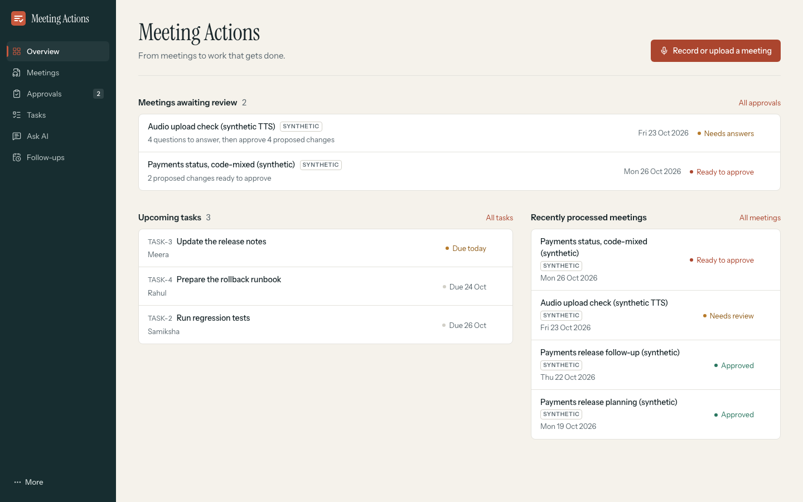
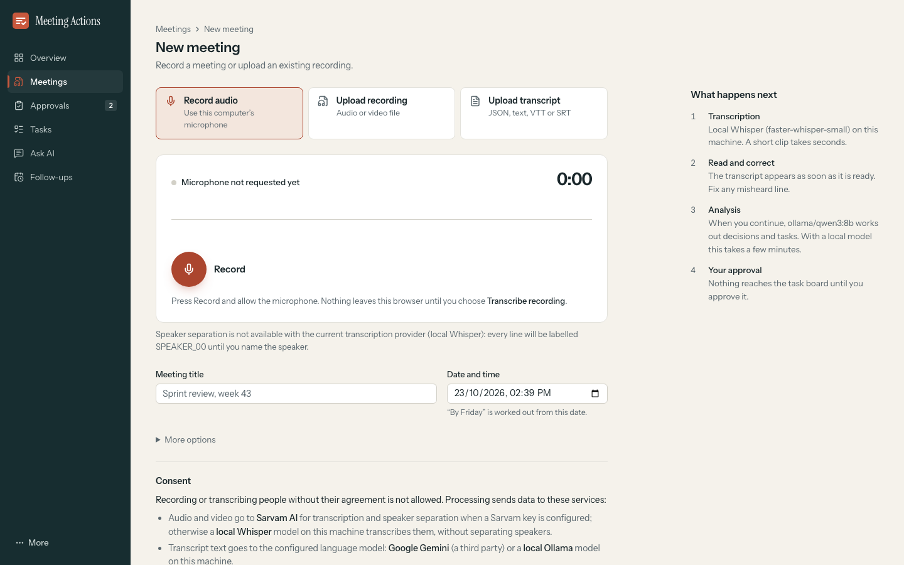
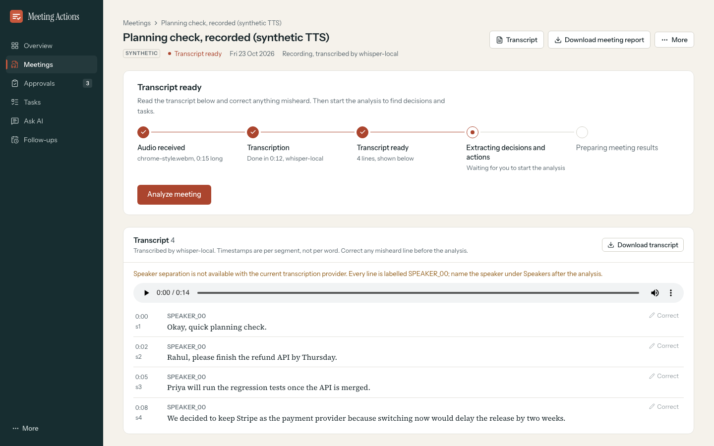
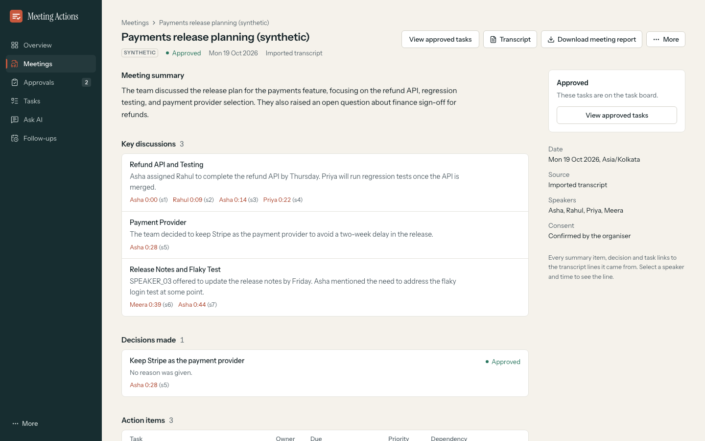
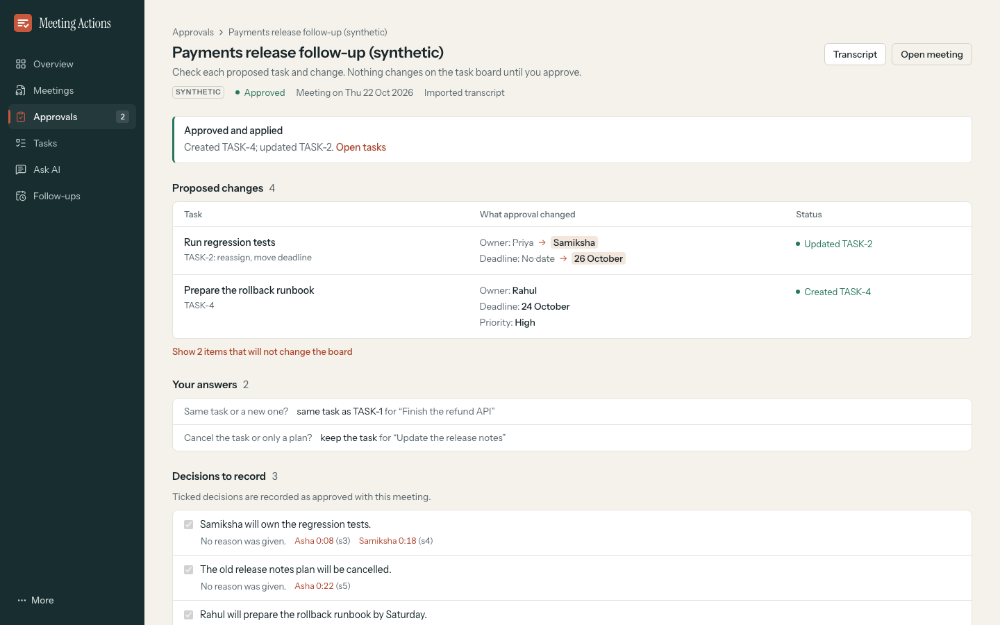
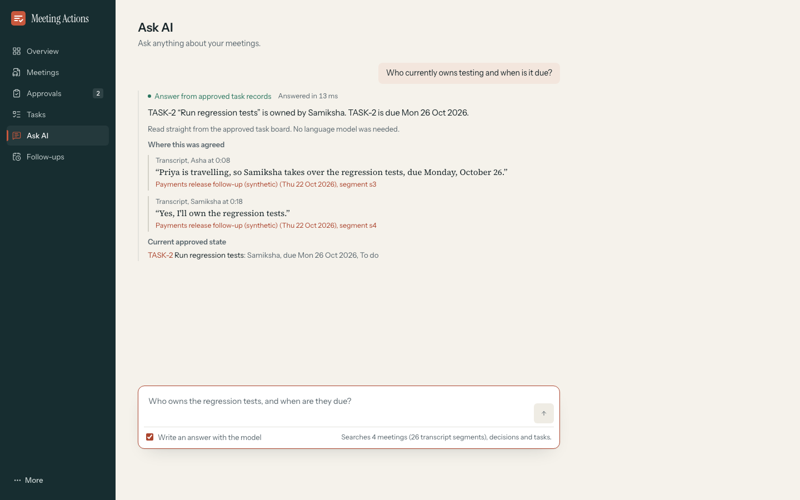
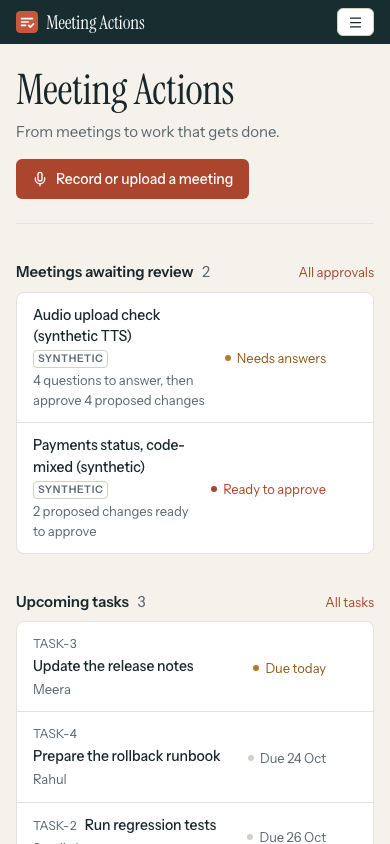
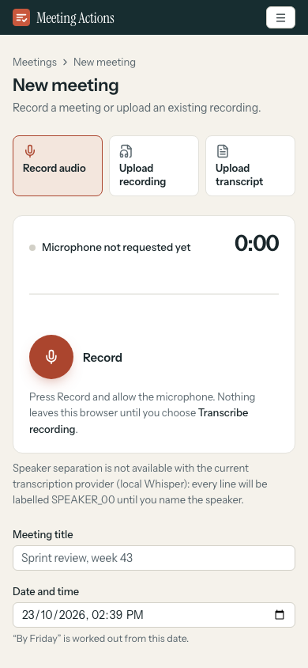
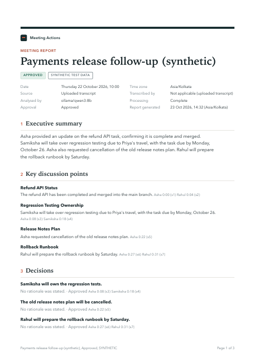
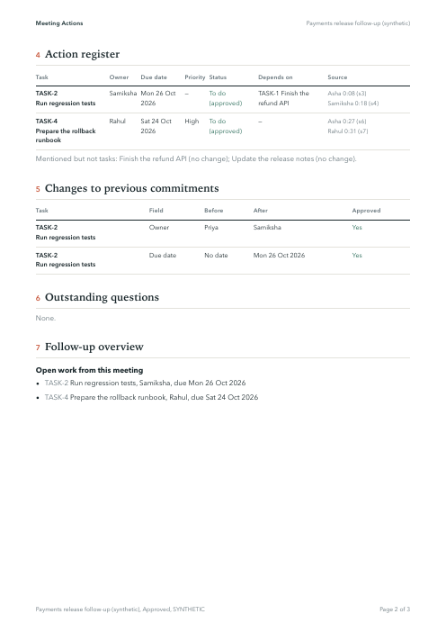

# Meeting Actions: Round 2 technical report

VIT Zero Shot Hack 2026 · Track 5, GenAI & Agentic Intelligence · PS 5.3 Meeting-to-Action
Tracker Agent · 23 October 2026. Every figure here was measured on the demo laptop (Intel Core
i9-9980HK, 16 threads, macOS, no GPU acceleration) unless it says otherwise. Synthetic
engineering tests are kept apart from the official real-meeting evaluation, which has **not**
been done.

## 1. Project overview

Meeting Actions turns a meeting (recorded in the browser, uploaded as audio or video, or
imported as a transcript) into reviewed, tracked commitments: minutes, decisions with reasons,
and tasks with owner, deadline, priority and dependencies, each tied to the words that support
it. Nothing becomes a task until the organiser approves it. Later meetings update the existing
tasks instead of duplicating them, and the history of every change is kept.

## 2. Problem statement

PS 5.3 asks for an agentic system that takes a meeting recording or transcript, identifies
speakers, produces minutes with decisions and their reasons, extracts actions with owner,
deadline and priority, asks for human confirmation, creates tasks and calendar entries, sends
follow-ups, and answers questions about past meetings with references to the exact discussion,
including meetings that mix English with Indian languages. Core question: *after every
meeting, does everyone know what was decided, what they have to do, and by when?*

## 3. What the solution does

1. **Capture**: record with the browser's microphone (level meter, playback, re-record), or
   upload audio, video or a transcript, after a consent confirmation.
2. **Transcribe first**: speech-to-text runs on its own; the timestamped transcript is shown as
   soon as it exists and can be corrected before any model call.
3. **Analyse**: the language model only describes what was said, as ordered typed events
   (propose, confirm, reassign, change deadline, cancel, complete…). Deterministic rules fold
   them into the current state of the work and check it against the task board.
4. **Ask, don't guess**: unclear owners, anonymous speakers, ambiguous dates or cancellations,
   and possible duplicates become ranked questions for the organiser.
5. **Approve**: a review shows every change as before → after; approval is pinned to exactly
   what was reviewed and refused if the board changed meanwhile.
6. **Follow up**: task board with dependency gating, revision history, reminders, calendar
   export, next-meeting agenda, an approval-gated summary, and a PDF meeting report.
7. **Remember**: questions about current task state are answered from the approved records in
   milliseconds; questions about the discussion get grounded answers with cited passages.

## 4. Architecture

```
Browser (React, Vite)                FastAPI backend (Python 3.12, SQLite)          Local services
─────────────────────                ─────────────────────────────────────          ──────────────
New meeting ── record / upload ──▶   POST /meetings/{id}/upload                     FFmpeg / ffprobe
  MediaRecorder (WebM, MP4, Ogg)       consent check, type and size checks ───────▶ normalise to 16 kHz WAV
                                       transcribe_only → status "transcribed" ────▶ faster-whisper (small)
Transcript (polled) ◀─────────────   GET  /meetings/{id}                            (Sarvam Batch if keyed)
  correct a line ───────────────▶    PATCH /segments/{key}  (new revision)
  Analyze ──────────────────────▶    POST /process {interpret, minutes} ──────────▶ Ollama qwen3:8b
                                       events ──▶ reconcile() rules ──▶ proposal     (Gemini if keyed)
Approvals ── approve(hash) ─────▶    POST /changesets/{id}/approve  ──▶ tasks + revisions
Tasks · Follow-ups · Ask AI ────▶    /tasks · /reminders · /agenda · /calendar.ics · /memory
Report ─────────────────────────▶    GET  /meetings/{id}/report.pdf ──────────────▶ headless Chromium
```

Each processing step commits on its own, so a later failure never removes an earlier result.
The minutes request runs alongside the interpretation (it needs only the transcript).

## 5. AI and speech providers actually used

| Role | Provider used for every result in this report | Alternatives (implemented, not verified live) |
|---|---|---|
| Speech-to-text | local **faster-whisper `small`** (CPU, int8), segment timestamps, no diarization | Sarvam saaras:v4 Batch with diarization: **no key** |
| Language model | local **Ollama `qwen3:8b`**, temperature 0, seed 7, JSON-schema output, thinking off | Gemini: **no key** |
| PDF | headless Chromium (Playwright's build), system fonts | Chrome / Edge / `PDF_CHROME` |
| Search | SQLite FTS5 with citation validation | — |

## 6. Workflow

```
 Record / upload ─▶ Audio received ─▶ Transcription ─▶ Transcript ready ─▶ [organiser corrects]
                                                                      │
                     ┌────────────────── Analyze meeting ◀───────────┘
                     ▼
     Extracting decisions and actions ─▶ Preparing meeting results ─▶ Results + questions
                                                                          │
                     Review: answer questions, edit, exclude ◀────────────┘
                                         │ approve (pinned to the reviewed hash)
                                         ▼
               Task board (revisions, dependencies) ─▶ reminders · calendar · agenda · report · Ask AI
```

## 7. Core features

Browser recording with measured input level; transcript-first processing with corrections;
five real processing stages; minutes, discussions, decisions with rationale, open questions;
action items with owner, due date, priority and dependencies; ranked clarification questions;
before → after approvals with stale-board protection; one persistent task identity across
meetings with immutable revisions; dependency gating; reminders and calendar export;
next-meeting agenda; approval-gated summary sharing; Ask AI with a fast task-record path and a
grounded path; A4 PDF meeting report; presentation intro; demo workspace that never touches
real data.

## 8. Original differentiation

- **Commitment state, not just extraction.** The model emits typed events; a deterministic fold
  decides the current state. Reassignments update the same task, ambiguous cancellations are
  asked about, suggestions stay suggestions, and nothing is duplicated.
- **Identity protection.** A diarization label is never a person; "I will" becomes an owner only
  after the speaker is mapped; a named owner must come from the meeting; a requester is not made
  the owner of their own request without a first-person commitment.
- **Pinned approval.** What the organiser reviewed is exactly what is applied, or nothing is.
- **Honest output.** Unsupported questions get "not found"; proposals are never labelled
  approved; synthetic data is labelled SYNTHETIC everywhere, including the PDF.

## 9. UI screenshots {page}













{half}
{half}

## 10. Audio transcription evidence

| Test | Input | Result |
|---|---|---|
| Browser recording, end to end (`live-audio.spec.ts`, 3 runs) | Chromium capture device playing a 12 s TTS sentence | transcript on screen 6.5–6.6 s after *Transcribe recording* (includes the model load); words correct |
| Judge scenario A (`judge/live.spec.ts`, 2 runs) | 13 s TTS sentence, then live analysis | transcript 8.4 s; analysis 70.8 s and 94.7 s; correct proposals; PDF |
| Server transcription, model loaded | 14.7 s clip | 4.6–5.0 s (`small`); `base` 1.7 s, not adopted |
| Safari, Firefox and Chrome recording formats | AAC `.m4a`, Opus `.ogg`, Opus `.webm` | 4.8 s each, words correct |
| A person speaking into the laptop microphone | — | **BLOCKED** (macOS denies the developer tools microphone access); operator preflight in `docs/LIVE_AUDIO_DEMO.md` |

All speech above is synthetic (macOS text-to-speech). No real meeting recording was processed.

## 11. Multi-speaker status

**Diarization BLOCKED**: it needs the Sarvam Batch API and a key, which is not configured.
With local Whisper every segment is `SPEAKER_00`; the recording screen, the transcript and the
report say that speaker separation is not available, and judge scenario B confirms two voices
are not presented as two speakers. Speakers can be named afterwards; a name changes ownership
only through the identity rules above.

## 12. Baseline vs reconciliation (synthetic fixtures)

Same model and settings for every pipeline (`evaluation/run_eval.py`). *Baseline*: one call
returns the final actions. *Baseline + dates*: plus the deterministic date and anonymous-owner
rules. *Engine*: typed events, then `reconcile()`.

| Fixture set (live run) | Baseline F1 | Baseline + dates F1 | **Engine F1** | Safety checks (B / B+d / E) | Fully correct (B / B+d / E) |
|---|---|---|---|---|---|
| Starter, 12 cases, qwen3:8b (pre-registered) | 0.348 | 0.696 | **0.818** | 5/8 · 5/8 · **8/8** | 6 · 7 · **10** of 12 |
| Starter, 12 cases, llama3.1:8b | 0.720 | 0.800 | **0.900** | 4/8 · 4/8 · **8/8** | 8 · 8 · **10** of 12 |
| Fresh holdout v2, 10 cases, qwen3:8b | 0.500 | **0.750** | 0.625 | 5/10 · 5/10 · **10/10** | 3 · 3 · **7** of 10 |
| Fresh holdout v3, 8 cases, qwen3:8b (Round 2, first run) | 0.333 | **0.667** | 0.545 | 2/7 · 2/7 · **5/7** | 3 · 4 · **5** of 8 |

The engine is consistently **safer** (it asks instead of guessing or duplicating) and gets
more whole cases right, but on the two fresh holdouts it is **not** better on item-level F1 than
the baseline with date rules. After the Round 2 owner rules, a replay of the recorded v3
responses gives 0.727 / 6/7 / 6 of 8; that number is post hoc and not a held-out result. All
fixtures are synthetic and written by the developers.

## 13. Test results

| Command | Environment | Input | Pass | Fail | Skip |
|---|---|---|---|---|---|
| `cd backend && .venv/bin/pytest -o addopts=""` | macOS, Python 3.12 | recorded LLM JSON; real Whisper, FFmpeg, Chromium where present | 133 | 0 | 0 |
| `cd frontend && npx tsc -p tsconfig.app.json --noEmit` | Node 24 | source | exit 0 | — | — |
| `cd frontend && npx playwright test e2e/flows --grep-invert "upload → processing\|ask with the model\|model is down\|diagnostics live test"` | headless Chromium, disposable sandboxes | synthetic demo data; synthetic speech through the capture device; real Whisper | 105 | 0 | 0 |
| `cd frontend && npx playwright test e2e/flows/slow.spec.ts` | + live Ollama `qwen3:8b` | synthetic transcripts | 4 | 0 | 0 |
| `cd frontend && npx playwright test e2e/judge` | + live Whisper and Ollama | demo data; synthetic speech | 7 | 0 | 0 |
| `SCREENS=1 VW=1440\|1024\|390 [THEME=dark] npx playwright test e2e/screens.spec.ts` | headless Chromium | every route | 4 runs | 0 | 0 |
| `E2E_TOKEN=… npx playwright test e2e/smoke.spec.ts` | the live demo server | demo workspace, read-only | 4 | 0 | 0 |
| `python scripts/demo_workspace.py verify` | the live demo server | demo workspace, read-only | 12 checks | 0 | 0 |
| Accessibility: axe WCAG 2.1 A/AA in `a11y.spec.ts` (every route, both themes, drawers, dialogs, intro) | included in the fast suite | | 0 violations | | |

Not run because the dependency is missing (reported as BLOCKED, not PASS): a person speaking into
the demo laptop's microphone; Sarvam diarization; Gemini; email delivery (no SMTP).

GitHub CI runs the offline backend tests and the frontend build only; green CI does not prove
the microphone, the live model or the PDF renderer.

## 14. Measured latency

| Measurement | Result |
|---|---|
| Transcription, 14.7 s clip, model loaded | 4.6–5.0 s |
| *Transcribe recording* → words on screen (browser, includes model load) | 6.5–8.4 s |
| Full analysis after transcription (interpretation + minutes in parallel) | 70.8–94.7 s over 3 runs (was 139.2 s one after the other) |
| Ask AI from task records | median 4.0 ms over HTTP (18 runs); 20 ms in the UI |
| Ask AI grounded answer (model) | 17.9–40.0 s (3 runs, Round 1); 31.8 s (Round 2) |
| PDF report | 0.35–0.7 s; 3 pages typical, 10 pages for a 192-line transcript |

## 15. Privacy and authorisation

- Consent: every input mode requires the organiser's confirmation that participants agreed,
  with a statement of which services receive the data; the meeting records the consent.
- Everything runs on this laptop: local Whisper, local Ollama, SQLite, local files. Nothing is
  sent to a third party unless Gemini or Sarvam keys are configured (they are not).
- Every API route needs the organiser token (401 otherwise); media is served through signed,
  expiring URLs; keys and the token live in a git-ignored `.env` and are never shown.
- No task is created, and no message sent, without approval; email needs SMTP, which is not
  configured, so the app reports summaries and reminders as "not sent".
- The demo runs on a separate workspace; the working database is never changed by the demo
  or the tests.

## 16. PDF meeting report

`GET /api/meetings/{id}/report.pdf`, built only from stored records: header with approval and
SYNTHETIC tags, executive summary, key discussion points, decisions and rationale, action
register, changes to previous commitments, outstanding questions, follow-up, transcript
appendix, notes on evidence and providers, running header and "Page N of M". Unapproved work is
marked DRAFT: PENDING APPROVAL; a meeting without analysis gets a transcript-only report.
Hindi and Kannada are shaped and embedded with system fonts.

{half}
{half}

## 17. Known limitations

- The physical microphone with a human speaker is not verified by the developers.
- No diarization without Sarvam; local Whisper labels every line SPEAKER_00.
- Code-mixed speech: on a synthetic clip, Kannada came out phonetically in Devanagari; Sarvam
  is the intended provider for code-mix.
- The 8B local model often misses implicit rationales; the analysis takes 70–95 s on this CPU.
- Timestamps are per segment, not per word.
- Only Safari and Firefox are installed on the demo laptop; their recording was verified at the
  file-format level, not with an automated browser.

## 18. Official requirement checklist (PS 5.3)

| # | Requirement | Where | Test | Measured result | Status | Remaining |
|---|---|---|---|---|---|---|
| 1 | Audio / video / transcript input | New meeting; `api/meetings.py` upload | live-audio, meetings, `test_transcribe_first` | record, m4a/ogg/webm/mp4, JSON/TXT/VTT/SRT accepted | **PASS** | — |
| 2 | Real transcription | `speech/whisper_local.py` | live-audio, judge A | words correct on synthetic speech | **PARTIAL** | real human speech not verified |
| 3 | Speaker diarization | `speech/sarvam.py` | provider SDK checks | not run | **BLOCKED** | Sarvam key |
| 4 | English + code-mixed Indian language | prompts, `identity.py`, dates | holdout v1–v3, meeting 3 | code-mixed text handled; code-mixed speech synthetic only | **PARTIAL** | real code-mixed speech |
| 5 | Structured minutes | `processing.step_minutes` | slow, judge A | summary, discussions, questions | **PASS** | — |
| 6 | Decisions and rationale | minutes + review | slow | decisions with rationale when stated | **PARTIAL** | implicit reasons often missed |
| 7 | Owners, deadlines, priorities, dependencies | `reconcile.py`, `dates.py` | 23+ fold tests, holdouts | see §12 | **PASS** | — |
| 8 | Ambiguity resolution | clarification questions | approvals, questions specs | every question type the review offers is answered and stored | **PASS** | — |
| 9 | Human approval | `changesets.py`, Approvals | approvals spec, judge D | pinned hash, stale 409, idempotent | **PASS** | — |
| 10 | Task integration | built-in board | taf spec | revisions, gating | **PASS** (built-in) | no Jira/Trello |
| 11 | Calendar events / export | `.ics` | taf spec | valid all-day events | **PASS** (export) | no live calendar sync |
| 12 | Email / chat summary sharing | summary approval | meetings spec | approval-gated; "not sent" without SMTP | **PARTIAL** | SMTP never configured |
| 13 | Reminders | reminder worker | taf, backend | in-app delivered | **PASS** (in-app) | email reminders need SMTP |
| 14 | Next-meeting agenda | `/api/agenda` | taf | from DB state | **PASS** | — |
| 15 | Searchable meeting memory | `memory.py`, `task_answers.py` | taf, final-ui, judge E | fast and grounded paths | **PASS** | — |
| 16 | Transcript references | everywhere | final-ui, links | every item links to its segment | **PASS** | — |
| 17 | Evaluation on three real meetings | `evaluation/real_eval.py` | — | not done | **BLOCKED / NOT MEASURED** | consented recordings |
| 18 | WER | `real_eval.py` | synthetic only (0.245) | — | **NOT MEASURED** | real recordings |
| 19 | Action precision / recall vs human annotation | `run_eval.py`, `real_eval.py` | synthetic only (§12) | — | **PARTIAL** | real annotations |
| 20 | Human-rated summary quality | rubric ready | — | — | **NOT MEASURED** | raters |
| 21 | Architecture and README | README, `docs/architecture.md` | — | — | **PASS** | — |
| 22 | Functional demonstration | demo workspace, judge suites | judge A–G | passes | **PARTIAL** | physical microphone check |
| 23 | Presentation and submission material | demo script, this report | — | no slides or video produced | **PARTIAL** | slides / video |

**The official submission is not fully compliant**: requirement 17 (three real meetings, one
code-mixed) and the real-data metrics 18–20 are not done.

## 19. Final demonstration walkthrough

1. `python scripts/demo_workspace.py reset` then `serve`; open http://127.0.0.1:8000 (the intro
   plays once; `?present=1` replays it).
2. Overview: meetings awaiting review, current tasks, recent history.
3. New meeting → Record → speak 10–20 s → Stop → Play → consent → *Transcribe recording*.
4. The words appear in seconds; correct one line; *Analyze meeting*. If the analysis runs long,
   open *Open a sample processed earlier* (a separate synthetic meeting, labelled as such).
5. Results → *Review and approve tasks*: one proposal with its transcript passage.
6. Approvals → meeting 2: Owner Priya → Samiksha on TASK-2; Tasks → TASK-2: revisions 1 and 2.
7. Tasks: TASK-2 no longer waits for the done refund API.
8. Ask AI: "Who currently owns testing and when is it due?": Samiksha, Mon 26 Oct, from the
   records, with the source line.
9. *Download meeting report* and open the PDF.
10. Close: meetings produce changing commitments; this keeps the current responsibilities clear.

## 20. GitHub and CI

| Item | Value |
|---|---|
| Repository | https://github.com/sgtsujith141-wq/Zeroshot-meeting_agent (public) |
| Branch | `main`, fast-forwarded from `live-audio`; no force pushes, history preserved |
| Round 2 commits | `288e7bb` holdout v3 pre-registration · `fc589df` pass 1 · `8708aee` pass 2 · `58e105f` pass 3 · `623f823` pass 4 · this report in the commit after |
| CI | GitHub Actions run 39927806788 (`8708aee`) and 39931889775 (`623f823`): backend and frontend jobs green |
| Rollback | `safety/pre-round2-9696250` is the last fully verified build before Round 2; `git checkout safety/pre-round2-9696250` restores it |
| Release tag | none: the official three-real-meeting evaluation is not done |
