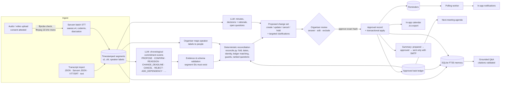

# Architecture

## System flow

## The design idea

The LLM never changes state. It does one narrow job: describe *what was said*, as an
ordered list of typed commitment events, each citing segment IDs. Everything that
decides *what is now true* is plain Python in `backend/app/services/reconcile.py`:

| Concern | Deterministic rule |
|---|---|
| Ordering | Events are folded chronologically by their first cited segment. Later corrections override earlier statements and are recorded as history. |
| Evidence | Events citing nonexistent segments are rejected. Partially valid citations are trimmed and a warning is raised. |
| Commitment strength | `tentative` / `question` proposals are suggestions, not tasks. A later firm statement or an acceptance promotes them. |
| Cancel vs reassign | `CANCEL(scope=assignment)` removes the owner and keeps the work. `CANCEL(scope=task)` cancels the work. An unclear scope never cancels approved work. A destructive cancel of approved work whose wording names a plan, approach or old version is downgraded to a question. |
| Identity | Diarization labels are never people. "I will…" sets an owner only when the speaker label is mapped. "We", "someone" and lists of names are not a single owner. A restatement with an unclear owner keeps the earlier clear owner. |
| Dates | `dates.py` resolves the spoken words against the meeting's local date, including romanised Hindi and Kannada terms. It never invents a clock time and flags ambiguity ("next Friday", a weekday that conflicts with the date, "next week", dd/mm vs mm/dd). |
| Cross-meeting | An event keyed to a ledger ID patches that task (before/after) after a plausibility check against the cited words. A change verb ("takes over") with a single strong title match patches that task, recording the match basis. A *new proposal* resembling a ledger task is held with a "same or new?" question. Several candidates are never resolved automatically. |
| Dependencies | Explicit `ADD_DEPENDENCY`, or `depends_on_key` on any work-item event. A rule-based cue detector ("once/after X is ready", Kannada *aadmele*, Hindi *ke baad*) links existing items only, never guesses on ties, and is labelled. Cycles are rejected. |
| Injection | Segments addressing the assistant, or trying to bypass review, are flagged. An item whose only evidence is such a segment is held. No event type can send, email or approve anything. |
| Clarifications | Ranked: whether the work exists or which task it is → ambiguous cancellation/reassignment → ownership/prerequisites → deadlines. While an item's existence is in question, its other questions are deferred, so the organiser sees the fewest questions. |

Because the fold is deterministic and cheap, re-running it after the organiser maps a
speaker or answers a question costs nothing and needs no model call. The organiser's
answers are an overlay (`changesets.overlay`) on the stored fold result.

## Approval and application

- A change set's proposal is hashed (SHA-256 of the canonical JSON).
- `POST /api/changesets/{id}/approve` must carry the hash the organiser reviewed. The
  server recomputes the proposal against the *current* ledger and refuses if anything
  differs. This blocks approving a stale view.
- Approval writes an `Approval` row (unique on scope + hash), then applies every
  operation in one transaction:
  - tasks are created or patched, each with an immutable `TaskRevision`;
  - dependencies are added with cycle protection;
  - the in-app calendar entry and reminder are created;
  - decisions are recorded;
  - the memory index is updated.
- If a task changed since the proposal was computed (revision mismatch), the whole
  apply is rolled back and the change set is marked `FAILED`.
- A repeated approval of the same hash returns the stored result
  (`idempotent_replay: true`). Concurrent duplicates collapse via the unique constraint.
- The UI disabling buttons is cosmetic. The rules are enforced by the API (see
  `backend/tests/test_api_flow.py`).

## Components

| Path | Responsibility |
|---|---|
| `backend/app/services/llm/` | Gemini (`google-genai`, `response_json_schema`) and local Ollama (JSON-schema `format`) adapters. Schema-repair retry. No fake provider. |
| `backend/app/services/speech/sarvam.py` | Sarvam batch STT with diarization (create → upload → start → wait → download). |
| `backend/app/services/transcripts.py`, `media.py` | Import parsers; ffprobe/ffmpeg via argument lists with timeouts; server-chosen storage names. |
| `backend/app/services/pipelines.py`, `prompts.py` | Baseline and candidate pipelines with shared rules and few-shot example. |
| `backend/app/services/reconcile.py`, `dates.py`, `identity.py`, `similarity.py` | Commitment reconciliation engine. |
| `backend/app/services/changesets.py` | Change-set build, overlay, approval, transactional apply. |
| `backend/app/services/tasks.py` | Finite status transition table, prerequisite gating, cycle checks, revisions. |
| `backend/app/services/calendar.py`, `reminders.py`, `summary.py`, `agenda.py`, `memory.py` | Follow-up features. |
| `backend/app/services/processing.py` | Single-worker job queue: STT → events → minutes → change set. |
| `backend/app/api/` | REST API (see `docs/api.md`). |
| `frontend/src/` | React organiser UI. |
| `evaluation/` | Fixture experiment (`run_eval.py`), real-meeting metrics (`real_eval.py`), rubric, results. |

## Stack choices and deviations from the brief

| Brief | What was built | Why |
|---|---|---|
| Gemini `gemini-3.8-flash` | Adapter implemented and configurable. **Not verified**: no `GEMINI_API_KEY` was available. The local Ollama `qwen3:8b` (and `llama3.1:8b` for robustness) served as the "same available model" for every live run. | The brief requires a real model and forbids inventing access. Ollama was the only model actually reachable. |
| Sarvam `saaras:v4` batch + diarization | Adapter follows the documented SDK flow. **Not verified**: no `SARVAM_API_KEY`. Transcript import works without it. | Same reason. |
| APScheduler or a polling worker | A polling thread over the SQLite `reminder` table. | Fewer moving parts; state is durable in the DB. |
| SQLModel + SQLite | As briefed. A schema initialiser creates missing tables only (no destructive migrations). | Single-file local demo. |
| FTS5 memory | As briefed. No vector DB. | Enough for a handful of meetings, and exact citations. |
| Approval enforced by the backend | Bearer-token organiser auth on every route except `/api/health`, plus hash-pinned approvals. | The brief: do not trust the client. |
